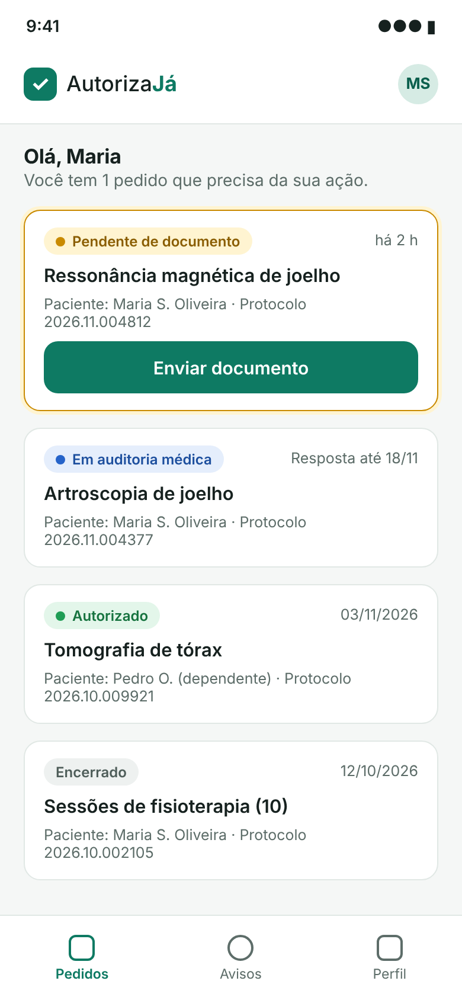
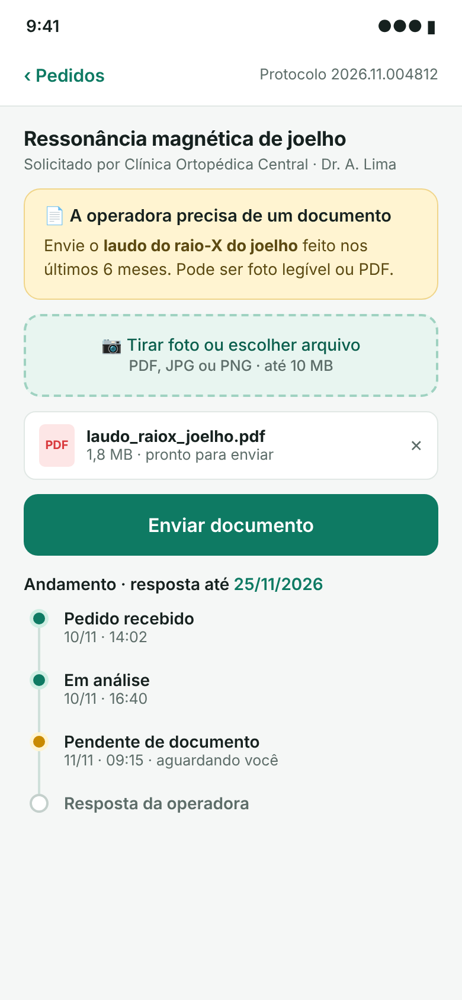
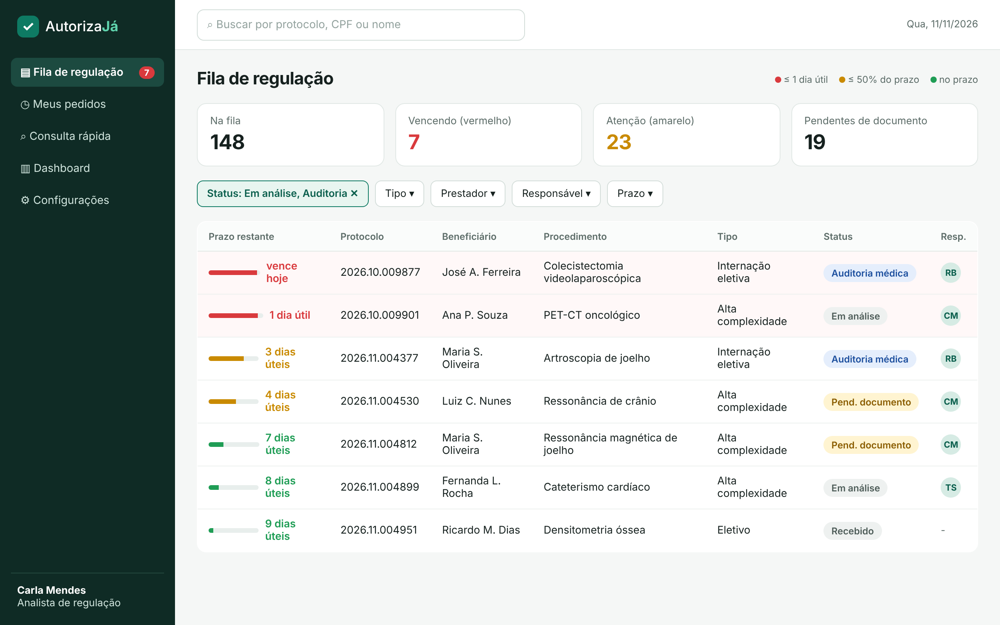
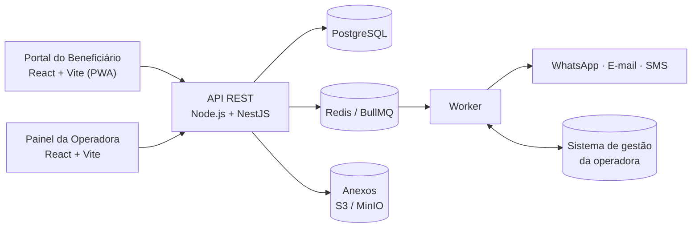

# AutorizaJá

Plataforma para o beneficiário de plano de saúde **acompanhar a autorização de exames e procedimentos pelo celular**. Para a operadora, organiza uma **fila de regulação ordenada pelo prazo regulatório** de cada pedido.

> Projeto acadêmico, UNIFACISA · Autor: Tony Tomaz · 2026
> **Status:** concepção e arquitetura concluídas (Macro Entregas 1 e 2). Implementação prevista a partir da Sprint 1.

## O problema

Entre o pedido médico e a resposta da operadora, o beneficiário não sabe em que etapa está o pedido, descobre pendências de documento só ligando para a central e recebe a resposta por canais diferentes. A operadora, por sua vez, recebe muitas ligações do tipo "como está meu pedido?" e não tem uma visão clara de quais pedidos estão perto de estourar o prazo exigido pela ANS.

## A solução

| Portal do Beneficiário (PWA) | Painel da Operadora |
|---|---|
| Login com CPF + código no celular | Fila de regulação ordenada pelo prazo, com semáforo |
| Lista de pedidos e linha do tempo de status | Solicitação de documento ao beneficiário |
| Envio de documento pendente por foto ou PDF | Parecer com negativa fundamentada obrigatória |
| Avisos por WhatsApp e e-mail | Dashboard de prazos e pendências |

<p align="center">
  
  
</p>
<p align="center">
  
</p>

## Documentação

### Macro Entrega 1: Concepção, Planejamento e Engenharia de Requisitos

1. [Documento de Visão do Projeto](docs/fase-1/01-Documento_de_Visão_do_Projeto.pdf)
2. [Especificação de Requisitos](docs/fase-1/02-Especificação_de_Requisitos.pdf)
3. [Histórias de Usuário](docs/fase-1/03-Histórias_de_Usuário.pdf)
4. [Product Backlog](docs/fase-1/04-Product_Backlog.pdf)
5. [Plano de Utilização de IA](docs/fase-1/05-Plano_de_Utilização_de_IA.pdf)

### Macro Entrega 2: Arquitetura, Modelagem e Prototipação

1. [Documento de Arquitetura de Software](docs/fase-2/01-Documento_de_Arquitetura_de_Software.pdf)
2. [Diagramas de Modelagem](docs/fase-2/02-Diagramas_de_Modelagem.pdf)
3. [Modelo de Dados](docs/fase-2/03-Modelo_de_Dados.pdf)
4. [Protótipos de Interface](docs/fase-2/04-Protótipos_de_Interface.pdf)
5. [Estrutura Técnica do Projeto](docs/fase-2/05-Estrutura_Técnica_do_Projeto.pdf)

Os diagramas estão versionados como código Mermaid em [`docs/diagramas`](docs/diagramas). O GitHub renderiza esses arquivos quando eles são colados em um bloco ` ```mermaid `.

## Arquitetura

Monólito modular em camadas, com processamento assíncrono para notificações e integração com o sistema de gestão da operadora.



## Tecnologias

| Camada | Tecnologias |
|---|---|
| Frontend | React 18, Vite, TypeScript, Tailwind CSS, TanStack Query, PWA |
| Backend | Node.js 20, NestJS 10, Prisma, BullMQ |
| Dados | PostgreSQL 16, Redis 7, armazenamento S3 compatível (MinIO) |
| Qualidade | Jest, Vitest, Playwright, ESLint, Prettier, Conventional Commits |
| Infraestrutura | Docker Compose, GitHub Actions, Nginx |

## Estrutura do repositório

```text
Autoriza-ja/
├── apps/
│   ├── api/                    # Backend NestJS (monólito modular)
│   ├── portal-beneficiario/    # PWA do beneficiário
│   └── painel-operadora/       # Painel interno da operadora
├── packages/
│   ├── shared-types/           # Tipos compartilhados entre front e back
│   └── ui/                     # Componentes visuais comuns
├── docs/
│   ├── fase-1/                 # Artefatos da Macro Entrega 1
│   ├── fase-2/                 # Artefatos da Macro Entrega 2
│   ├── diagramas/              # Fontes Mermaid dos diagramas
│   ├── prototipos/             # Imagens das telas
│   └── adr/                    # Registros de decisão arquitetural
├── infra/
│   └── docker-compose.yml      # PostgreSQL, Redis, MinIO e Mailpit
├── .env.example
└── README.md
```

## Como executar (após a Sprint 1)

```bash
git clone https://github.com/Thezntt/Autoriza-ja.git
cd Autoriza-ja
cp .env.example .env
docker compose -f infra/docker-compose.yml up -d
pnpm install
pnpm --filter api prisma migrate dev
pnpm dev
```

Hoje já é possível subir a infraestrutura local (`docker compose ... up -d`). Os comandos `pnpm` passam a funcionar quando os aplicativos forem criados na Sprint 1.

## Roadmap

- [x] Macro Entrega 1: visão, requisitos, histórias, backlog e plano de IA
- [x] Macro Entrega 2: arquitetura, diagramas, modelo de dados, protótipos e estrutura técnica
- [ ] Sprint 1: base técnica, integração de leitura e login dos dois perfis
- [ ] Sprint 2: lista de pedidos, prazos e fila de regulação
- [ ] Sprint 3: documentos pendentes, notificações e parecer
- [ ] Sprint 4: negativa formal, auditoria e retorno ao sistema de gestão (**release do MVP**)

## Padrões de contribuição

- Uma branch por item do backlog: `feat/US05-envio-documento`, `fix/...`, `docs/...`
- Commits no padrão [Conventional Commits](https://www.conventionalcommits.org/pt-br/): `feat(documentos): permite envio de foto (US05)`
- Toda mudança entra por pull request, usando o template do repositório

## Uso de IA

Os artefatos foram elaborados com apoio de ferramentas de IA e revisados criticamente pelo autor, conforme descrito no [Plano de Utilização de IA](docs/fase-1/05-Plano_de_Utilização_de_IA.pdf). Todos os dados exibidos nos protótipos são fictícios.

## Licença

[MIT](LICENSE)
